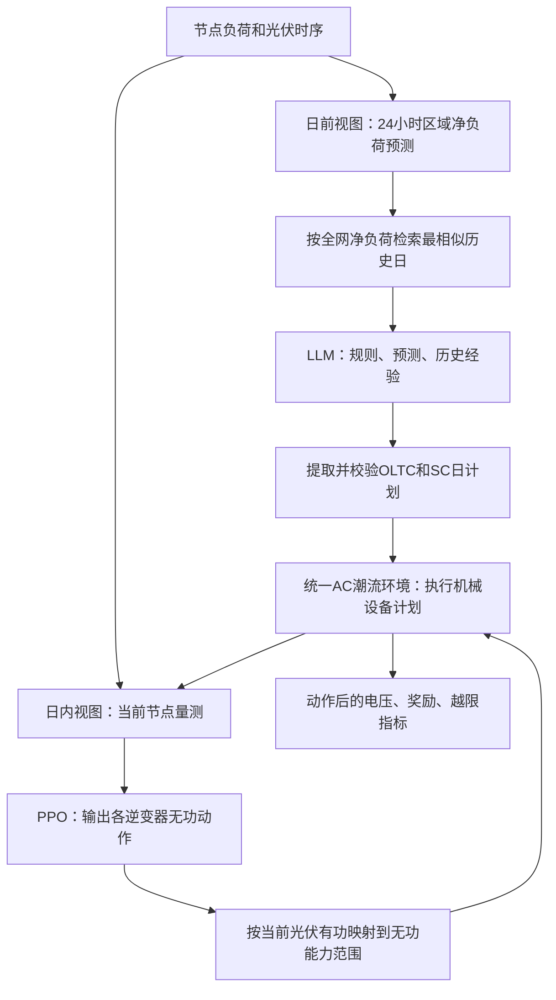

# LLM-RL 两阶段配电网电压控制：复现架构与基线清单

> Source coverage: Full paper；正文 15 页，补充材料 18 页。
> Extraction confidence: Mixed；正文可提取，表格和部分补充图需视觉核读。
> Locator mode: page-grounded；以下 PDF 页码均从文件首页起计。
> Primary analytical lens: methods。
> Secondary analytical lens: None。
> Context verification: Targeted external check；仅核对作者补充仓库，不作领域查新。
> Card completeness: Complete relative to supplied source；复现缺失信息明确保留。

阅读日期：2026-11-02。本文区分 `[Paper]` 原文报告、`[External]` 外部核验、`[Analysis]` 复现判断、`[Hypothesis]` 待验证建议。正文保留在用户原论文目录；本文件及下载资料保存在当前对话工作目录，没有修改 Obsidian 原文或笔记。

**复现重点：先统一潮流环境、数据和评价口径，再搭建“日前 LLM 调机械设备 + 日内 PPO 调逆变器”的两阶段流程。需要恢复原文 7 个基线，并优先解决数据、约束语义、训练预算和信息公平性。**

## 01 基本信息

| 项目 | 信息 |
|---|---|
| 标题 | Two-Stage Active Distribution Network Voltage Control via LLM-RL Collaboration: A Hybrid Knowledge-Data-Driven Approach |
| 作者 | Xu Yang、Chenhui Lin、Xiang Ma、Dong Liu、Ran Zheng、Haotian Liu、Wenchuan Wu |
| 单位 | 清华大学四川能源互联网研究院；国网浙江金华供电公司 |
| 期刊 | IEEE Transactions on Smart Grid，17(6)，5188–5202，2026 |
| DOI | 10.1109/TSG.2026.3710392 |
| 类型 | 方法/系统论文：两阶段控制架构及离线策略改进 |
| 实验对象 | 文中称 IEEE 33-bus、141-bus 配电系统 |
| 公开材料 | 作者仓库当前根目录仅见补充 PDF；未见可运行源码、权重或原始年度数据 |
| 本轮目标 | 梳理复现架构、确定比较基线和待冻结配置；没有运行训练或电网控制实验 |

[Paper: PDF p. 1, Metadata] [Paper: PDF p. 14, References 37 and 40]

[External] 核验入口：[作者仓库](https://github.com/YangXuSteve/Knowledge-Data-Driven)。所下载补充文件见 [supplementary.pdf](supplementary.pdf)，仓库所列文件 blob SHA 为 `0defb9bf3c55c12c9099a14e939982afb74e3858`。该文件包含拓扑、测试日曲线、知识模板和提示词；曲线图片不能替代原始时序。

术语固定如下，避免基线命名产生歧义：

| 术语 | 含义 | 本文件采用的口径 |
|---|---|---|
| OLTC | on-load tap changer，有载调压变压器 | 日前确定档位及调整时刻 |
| SC | shunt/switched capacitor，并联/投切电容器 | 日前确定是否投入及一个连续投入区间 |
| PV inverter | 光伏逆变器 | 日内调节无功，光伏有功作为外生数据 |
| Reflexion | 基于执行反馈的反思改进 | 离线重试并更新经验库，不更新 LLM 权重 |
| Pretrain-finetune | PPO 预训练后微调 | 先适应随机机械设备状态，再适应冻结的 LLM 策略 |
| Original | 原文的无控制基线 | OLTC 零档、SC 断开、PV 无功为零 |
| No-LLM | 原文设备消融名称 | 关闭 OLTC/SC，仅保留 PV 无功控制；不等于用另一调度器替换 LLM |

## 02 一句话总结

[Paper] 用 LLM 处理粗粒度预测和语义约束以安排 OLTC/SC，再用 PPO 根据节点实时量控制光伏无功；在两个仿真网络上，完整方法的电压偏差和越限率优于文中非 MISOCP 对照。[Paper: PDF p. 3, Figure 1] [Paper: PDF p. 11, Table III] [Paper: PDF p. 12, Table IV]

## 03 研究问题

[Paper] 日前只能获得区域级、含误差的净负荷预测，又要遵守机械设备的日操作约束；日内才有准确节点量测。研究问题是：能否利用两阶段不同的信息，把机械设备的慢调节与逆变器的快调节有效协调？[Paper: PDF p. 2, Introduction] [Paper: PDF p. 4, Section II-A]

[Analysis] 复现应分别验证：机械设备是否有贡献、PV 无功是否有贡献、LLM 是否优于可比的日前调度器、Reflexion 是否有效、PPO 预训练是否有效。不能用一个总奖励结果同时回答全部问题。

## 04 背景与技术位置

[Paper-framed; external verification not performed] 作者从传统模型优化、单/多智能体 RL、双时间尺度 RL，转向由 LLM 与 RL 分别承担日前和日内决策。这里仅重建论文的定位，没有独立证明其首创性。[Paper: PDF p. 2, Introduction]

[Analysis] 这是“两个控制器按时间尺度分工 + 离线策略改进”的系统。LLM 不直接输出每 15 分钟的逆变器动作；PPO 也不负责理解自然语言运行指令。

## 05 原文针对的痛点

| 痛点 | 表现 | 作者解释 | 对复现的要求 |
|---|---|---|---|
| 日前信息不完整 | 只有区域小时预测 | 节点精细预测难获取 | 普通方法不能偷偷使用真实节点未来值 |
| 输入异质 | 预测、历史电压报告、操作规则并存 | 普通 RL 难直接处理语义 | 固定结构化与文本输入接口 |
| 机械约束跨时段 | OLTC 日次数、SC 连续投入区间 | 可行动作受日内历史影响 | 共享同一套约束检查器 |
| 反馈只有标量时难改进 | 相同偏差奖励可能对应过压或欠压 | LLM 可利用小时电压反馈 | 记录各区域及全网小时电压 |

[Paper: PDF p. 2, Introduction] [Paper: PDF p. 7, Section III-C]

## 06 核心思想

1. [Paper] 表层实现：日前 LLM 调 OLTC/SC；日内 PPO 调 PV 无功。[Paper: PDF p. 3, Figure 1]
2. [Paper] 策略改进：LLM 用相似日检索、3 轮 Reflexion、经验库替换；PPO 用随机机械状态预训练，再在 LLM 策略下微调。[Paper: PDF p. 6, Figure 3] [Paper: PDF p. 7, Figure 4] [Paper: PDF p. 9, Table II]
3. [Analysis] 可迁移的设计点是按信息可用时间和设备响应速度拆分任务；LLM 的价值必须通过同信息、同设备的替换基线验证。

## 07 复现总架构

### 7.1 在线控制的数据流



[Paper] 每天一次日前计划；日内 96 步，每步 15 分钟。机械设备由分段计划执行，不能在日内让 PPO 随意改动。[Paper: PDF p. 8, Section IV-A]

### 7.2 离线训练分成三件事

| 阶段 | 输入与操作 | 更新对象 | 结束条件/产物 |
|---|---|---|---|
| PPO 预训练 | 随机 OLTC/SC 设置 + 节点实时量；PV 无功与潮流环境交互 | PPO 网络 | 33/141 节点分别 1500/2500 episodes 的预训练权重 |
| LLM 策略改进 | 检索相似日→生成计划→仿真→反馈→3轮反思→选最好计划 | 经验库，不更新 LLM 权重 | 分别 200/250 episodes；冻结经验库 |
| PPO 微调 | 冻结 LLM 每天给出机械计划；PPO 接着训练 | PPO 网络 | 分别 150/200 episodes 的最终策略 |

[Paper: PDF p. 6, Figure 3] [Paper: PDF p. 9, Section IV-B]

[Analysis] 预训练可独立准备，但应与 LLM 改进阶段分别记账。训练曲线横轴不能隐藏 1500/2500 次预训练，也不能把一次含 4 次候选计划评估的 LLM episode 当成一次环境交互。

[Analysis] LLM 改进阶段 PV 无功究竟置零还是由固定控制器提供，需进一步确认。正文叙述为 LLM 稳定后才引入预训练 RL，支持“此时尚未用训练后的 PPO”的理解，但缺少代码不能锁死所有细节。

### 7.3 在线测试冻结项

[Paper] 测试时冻结经验库、PPO 参数，关闭 Reflexion；仍可对非法格式/非法计划进行约束纠错，这和利用真实测试日电压反馈优化计划是两回事。[Paper: PDF p. 11, Section IV-C] [Paper: PDF p. 13, Section IV-D]

[Analysis] 每个测试日只允许在日前看到预测。真实全天节点数据只交给环境逐步产生当时量测；不得用当天完整仿真结果挑选在线动作。

## 08 实现模块与接口

| 模块 | 输入→输出 | 原文作用/证据 | 复现边界 |
|---|---|---|---|
| 网络与设备 | 拓扑、阻抗、负荷、设备配置→潮流状态 | 式(2)–(9)；PDF 3–4页 | 统一单位、编号、正负号、参考节点 |
| 数据/预测 | 节点15分钟序列→区域24小时预测 | PDF 8页 | 区分真实值和预测值；固定噪声种子 |
| 日前 LLM | 规则、预测、相似日→离散日计划 | Figure 2；PDF 5页 | 原始响应、解析结果、重试均留档 |
| 约束校验 | 日计划→合法计划或错误清单 | PDF 5、13页 | 只校验格式与操作规则，不利用真实日电压选优 |
| 经验库 | 日预测、计划、奖励、电压→最近似经验 | Figure 4；PDF 7页 | 使用论文相似度，不擅自换 embedding 检索 |
| Reflexion | 执行反馈→修订候选→最佳候选 | PDF 7页 | 仅离线；独立统计每次全天重放 |
| PPO | 节点量测及机械状态→PV 无功动作 | PDF 6页；Table II | 连续动作；OLTC/SC 状态 one-hot 编码 |
| 实验编排 | 方法、种子、数据划分→训练/测试结果 | PDF 9、11页 | 所有方法共享测试日、噪声及设备能力 |

### 8.1 建议的代码边界（尚未实现）

```text
configs/       网络、设备、方法、种子和预算
data/          原始数据引用、节点映射、训练验证测试划分
env/           AC潮流、设备执行、观测、奖励、约束
agents/llm/    提示词、调用适配、解析、经验库、Reflexion
agents/rl/     PPO网络、预训练、微调
baselines/     Original、Pure-RL、各消融、MISOCP
evaluation/    配对测试、统计、绘图
runs/          按实验独立保存配置、日志、权重和结果
```

[Analysis] 编程语言和潮流库属于待定实现选择，不是原文已公开配置。可采用统一 Python 环境承载 LLM/PPO/潮流，或保留 MATLAB 潮流/优化并提供接口；第一步应确定一个共享环境，避免每个基线各自实现一套网络。

### 8.2 最容易写错的接口

- 参考节点电压由 OLTC 设置：以 1 p.u. 为基准，零档为 1，档位为 -5 至 5。
- 取“向网络注入”为正：负荷是负注入，PV 有功和容性无功是正注入。交流导纳采用节点导纳矩阵；参考节点相角固定为零。[Paper: PDF p. 3, Equation 2] [Paper: PDF p. 4, Equations 6–9]
- PPO 观测里的电压和 PV 无功必须说明是动作前量测还是上一动作结果。不能先用当前尚未输出的动作求电压，再把它当成输入。[Analysis]
- 映射动作时使用当前的 PV 有功和每台设备的额定视在容量；不可把无功上限写成全天固定常数。[Paper: PDF p. 4, Equation 5]

## 09 必要公式与已知配置

### 9.1 目标、奖励和动作

论文目标是全天节点电压幅值绝对偏差之和：

\[
\min \sum_{t=0}^{95}\sum_{i\in\mathcal N}|V_{i,t}-V_{ref}|,
\qquad V_{ref}=1.
\]

PPO 单步奖励为节点平均负绝对偏差：

\[
r_t=-\frac{1}{|\mathcal N|}\sum_i|V_{i,t}-1|.
\]

[Paper: PDF p. 3, Equation 1] [Paper: PDF p. 6, Equation 11]

无功动作可按原文描述实现为：

\[
u_{i,t}\in[-\lambda^{PV},\lambda^{PV}],\qquad
Q^{PV}_{i,t}=u_{i,t}\sqrt{(S_i^{PV})^2-(P_{i,t}^{PV})^2}.
\]

[Analysis] 这是与原文容量约束及动作区间一致的直接映射；如果内部动作归一化到 [-1,1]，应明确乘上 \(\lambda^{PV}\)，避免重复乘或漏乘。[Paper: PDF p. 4, Equation 5] [Paper: PDF p. 6, Section III-B]

### 9.2 相似日与经验库

\[
\varepsilon_{ij}=TS_{ij}MS_{ij},\quad
TS_{ij}=\frac{\sum_{h=0}^{23}\hat L_{i,h}\hat L_{j,h}}
{\sqrt{\sum_h\hat L_{i,h}^2}\sqrt{\sum_h\hat L_{j,h}^2}},\quad
MS_{ij}=\frac{\min(|\sum_h\hat L_{i,h}|,|\sum_h\hat L_{j,h}|)}
{\max(|\sum_h\hat L_{i,h}|,|\sum_h\hat L_{j,h}|)}.
\]

这里用的是全网 24 小时净负荷预测。最高相似度低于 0.7 时新增经验；否则与最近似经验比奖励，较好者保留。3 轮反思加初始计划，共 4 个候选。[Paper: PDF p. 7, Equations 14–16 and Figure 4] [Paper: PDF p. 9, Table II]

[Analysis] 净负荷正负抵消、全零预测会使幅值相似度或分母异常，原文未给边界处理。应将处理规则写入配置并记录为复现补充。

### 9.3 配置冻结表

| 项目 | 33 节点 | 141 节点 | 来源/状态 |
|---|---|---|---|
| 区域/SC/PV 数 | 3 / 3 / 6 | 5 / 5 / 10 | 正文 Table I |
| OLTC 档位、步长 | -5…5；0.006 p.u. | 同左 | Table I；式(2) |
| OLTC 调整次数 | 4 次/日 | 同左 | Table I；初始档位计数见下 |
| 单台 SC 容量 | 0.15 MVAr | 0.4 MVAr | Table I |
| \(\lambda^{PV}\) | 0.3 | 0.15 | Table I |
| 合格电压范围 | [0.95, 1.05] p.u. | 同左 | PDF 8页 |
| 日前/日内时间尺度 | 1小时 / 15分钟 | 同左 | PDF 8页 |
| 预测误差 | 5% 白噪声 | 同左 | 噪声的精确定义未提供 |
| LLM | Qwen-Plus，版本 2025-12-01 | 同左 | 原文 Table II；未核实该快照目前能否调用 |
| LLM 训练采样 | temperature 0.7；top-p 0.8 | 同左 | Table II |
| LLM 测试采样 | temperature 0.2；top-p 0.6 | 同左 | Table II |
| Reflexion / 相似度阈值 | 3轮 / 0.7 | 同左 | Table II |
| PPO 网络 | 2个隐藏层，每层256单元 | 同左 | 激活函数、策略分布等未完整提供 |
| mini-batch / \(\gamma\) | 32 / 0.9 | 同左 | Table II |
| 预训练学习率 | 1e-4 线性降至 1e-5 | 同左 | Table II |
| 微调学习率 | 1e-5 | 同左 | Table II |
| PPO clip / 更新次数 | 0.3 / 4 | 同左 | Table II |
| 预训练/LLM改进/微调 | 1500 / 200 / 150 episodes | 2500 / 250 / 200 | PDF 9页 |
| 测试 | 3 seeds × 每seed 25天 | 同左 | 每方法75个测试episode |

[Paper: PDF p. 8, Table I and Section IV-A] [Paper: PDF p. 9, Table II and Section IV-B] [Paper: PDF p. 11, Section IV-C]

### 9.4 机械约束的实际语义

[External] 补充 PDF 第11–13页：OLTC 计划包含 00:00 初始档位，之后最多 4 个调整时刻，因此最多 5 段；后续时刻是 1–23 的递增小时，邻段档位不同。SC 可以整天不投入，或选择一个开始/结束时刻定义连续投入区间。这不等于人为额外指定“只能在固定晚高峰窗口投入”。

[Analysis] 还需冻结：跨日初始档位如何衔接、一次跨多档算一次调整还是按档位差计数、SC 边界时刻是否半开区间、初始 SC 状态是否计投切。严格按该提示模板，OLTC 约束更接近“改变状态的时刻数”，而非绝对档位变化量之和。

### 9.5 全部公式的证据角色

| 公式 | 用途 | 位置 |
|---|---|---|
| Equation 1 | 电压绝对偏差目标 | PDF 3页 |
| Equation 2 | 根节点电压与 OLTC 档位 | PDF 3页 |
| Equation 3 | SC 节点无功注入 | PDF 3页 |
| Equation 4 | PV 节点无功注入 | PDF 4页 |
| Equation 5 | PV 无功能力范围 | PDF 4页 |
| Equation 6 | 节点有功注入 | PDF 4页 |
| Equation 7 | 其他节点无功负荷 | PDF 4页 |
| Equation 8 | AC 有功平衡 | PDF 4页 |
| Equation 9 | AC 无功平衡 | PDF 4页 |
| Equation 10 | RL 折扣回报目标 | PDF 5页 |
| Equation 11 | 单步电压奖励 | PDF 6页 |
| Equation 12 | PPO 重要性采样代理目标 | PDF 7页 |
| Equation 13 | PPO clipped surrogate objective | PDF 7页 |
| Equation 14 | 综合相似度 | PDF 7页 |
| Equation 15 | 趋势相似度 | PDF 7页 |
| Equation 16 | 幅值相似度 | PDF 7页 |

[Analysis] 式(13)是概率比值裁剪目标；不要把它和网络参数的梯度范数裁剪混为同一配置。

## 10 实验设计、比较基线与复现决策

### 10.1 原文 7 个基线必须如何定义

| 方法 | 日前 OLTC/SC | 日内 PV 无功 | 用来回答的问题 | 实现前必须定下来的细节 |
|---|---|---|---|---|
| Original | OLTC零档，SC关闭 | 0 | 不控制时问题有多严重？ | 保持相同PV有功及负荷，不是关闭光伏 |
| No-LLM | 关闭机械调节 | PPO | 机械设备是否有贡献？ | 不能解释为“用PPO替换LLM”；PPO独立训练还是直接消融待确认 |
| No-RL | LLM计划 | 0 | 逆变器快调节是否有贡献？ | 使用哪一版冻结LLM经验库；不要额外引入传统无功控制 |
| Pure-RL | 日前RL agent | 另一日内RL agent | 用RL替代日前LLM后如何？ | 两个agent，动作编码、观测、约束罚项、mask、训练次序与预算 |
| No-PT | 完整LLM机制 | 从随机权重开始微调PPO | 预训练是否有贡献？ | 保持与Proposed相同LLM；原文微调轮数相同，但总训练交互数不同 |
| No-Reflexion | 有检索及经验库更新，省掉反思 | 保留预训练和微调 | 反思是否有贡献？ | 不是关掉经验库；是否补齐同等候选评估次数需额外公平实验 |
| MISOCP | 完整模型与准确节点预测下联合优化 | 联合优化 | 理想信息下能达到何种参照性能？ | 精确预测属于oracle信息；明确数学模型、松弛和求解误差 |

[Paper: PDF p. 8, Section IV-A] [Paper: PDF p. 9, Section IV-A] [Paper: PDF p. 11, Section IV-C]

**完整方法 Proposed**：LLM + 相似日经验库 + Reflexion + PPO 预训练与微调。

[Analysis] Pure-RL 是最重要、也是目前细节最不足的替换基线。不能直接用一个 PPO 一次输出所有离散和连续动作后把性能归因于 LLM；原文明确是两个 RL agent。对于 No-LLM/No-RL，建议分别保留“关闭设备后的冻结策略诊断”和“在该条件下重新训练的比较”，并区分命名，避免部署分布变化混入设备贡献。

### 10.2 建议额外保留的两个公平性对照

以下是复现分析建议，不是作者已有基线，也不作为本轮新增算法实现。

| 建议对照 | 精确定义 | 价值 |
|---|---|---|
| Heuristic + PPO | 用区域净负荷规则生成合法OLTC/SC计划；与完整方法相同数据、设备和PPO流程 | 检查“有用的日前机械调节”是否已能解释大部分收益 |
| 同信息优化 + PPO | 在相同区域预测下，用明确声明的节点分配规则/估计模型生成机械计划；保持日内PPO | 避免只拿不易训练的Pure-RL来证明LLM价值；模型和映射是额外假设，需公开 |

[Analysis] 这两项适合在原文基线跑通后增加；第二项与使用真实节点未来值的 MISOCP 应单独命名、单独报告。

### 10.3 先确定哪些“基准设置”

| 优先级 | 待定项 | 已有证据 | 建议处理 |
|---|---|---|---|
| P0 | 复现目标 | 缺少原始数据与源码 | 先以机制复现为里程碑；原文数值对齐依赖补齐缺失资料 |
| P0 | 网络版本 | 正文引用33/141节点网络；补充提供拓扑 | 固定阻抗、负荷基值、S/V基准、支路状态、设备节点和区域映射；不能只写“IEEE33” |
| P0 | 年度数据及划分 | 正文只说一年PV/负荷数据；补充为测试曲线 | 需原始来源、采样、节点分配、PV容量、功率因数；若替代，明确标记 |
| P0 | 预测构造 | 5%白噪声 | 确认加性/乘性、标准差/幅度、节点先聚合还是聚合后扰动、全网与区域预测是否一致 |
| P0 | 机械约束 | 4次OLTC调整及SC连续区间 | 按9.4明确初始状态、跨日和次数定义 |
| P0 | 公共评价器 | 偏差、越限率、总奖励 | 统一分母、参考节点是否计入、时间步、单位及越限边界 |
| P1 | PPO完整配置 | Table II提供部分超参数 | 补齐GAE参数、激活函数、策略分布、动作处理、归一化、熵/价值系数、优化器、rollout长度 |
| P1 | 预训练分布 | 随机OLTC/SC状态 | 确认每步/每小时/每日采样、概率、是否满足日约束 |
| P1 | LLM可复现性 | 模型版本及采样参数明确 | 固定实际模型ID、提示词和调用记录；若换模型，属于替代实验 |
| P1 | 经验库冷启动 | “若干代表历史日” | 初始数量、选日、初始计划/奖励来源、空库行为未明确；所有种子留存快照 |
| P1 | Pure-RL | 两agent+罚项+mask | 冻结动作编码、罚系数、时间约束和学习预算；这是主要待补基线 |
| P1 | 总交互与调用预算 | 原文给episode数量 | 分别计预训练、微调、反思重放、LLM调用、失败重试及运行时间 |
| P2 | MISOCP细节 | DistFlow + 准确模型/预测 | 明确电压幅值或平方幅值目标、松弛精确性、整数gap、潮流恢复结果 |

[Analysis] 当前最值得向作者索取的是：①代码与环境版本；②原始时序和train/test索引；③PV额定容量及节点/区域映射；④Pure-RL定义与配置；⑤预训练随机化及初始经验库；⑥MISOCP具体模型与求解设置。不能用图中几条测试曲线推断出整年节点数据。

### 10.4 公共指标与预算记账

[Analysis] 建议明确采用以下评价定义；论文给出了名称，但没有在正文完整定义所有统计细节，因此这些是需冻结的复现口径：

\[
\mathrm{MAD}_{d}=\frac{1}{96|\mathcal N|}\sum_{t,i}|V_{i,t}-1|,
\]

\[
\mathrm{VR}_{d}=\frac{100}{96|\mathcal N|}\sum_{t,i}\mathbf 1\{V_{i,t}<0.95\ \mathrm{or}\ V_{i,t}>1.05\}\quad(\%).
\]

- 原始物理奖励与训练用附加罚项分开。原文明示：Pure-RL 的约束罚项不计入最终展示的奖励指标。[Paper: PDF p. 9, Section IV-A]
- 若日报酬定义为未折扣的 \(R_d=\sum_t r_t\)，则 \(R_d=-96\mathrm{MAD}_d\)。PPO 的折扣目标另记，不能直接混用。[Analysis]
- 保留每日原始结果、seed均值及跨seed离散程度；75个episode不是75次独立训练。
- 统一测试日和预测噪声，冻结训练/验证/测试划分。测试数据不用于经验库挑选和超参数选择。
- 约束合法率、纠错次数、调用失败、潮流不收敛也要保留，不能只删除失败episode。
- 电压曲线至少输出全网极值和目标节点曲线，不能仅报告区域平均电压掩盖局部越限。
- 正文曲线用25-episode移动平均；保留未平滑曲线，说明阴影表示标准差还是其他误差范围。[Paper: PDF p. 9, Section IV-B]
- Proposed 的反思每个训练日可产生4个候选，需记全部潮流调用。33节点200个LLM训练episode对应最多约800次候选日评估，尚未计格式纠错；这不是成本实测。[Analysis]

### 10.5 原文数值参照（不是本轮复现实测）

| 方法 | 33节点偏差均值 / p.u. | 33节点越限率 / % | 141节点偏差均值 / p.u. | 141节点越限率 / % |
|---|---:|---:|---:|---:|
| Original | 2.50e-2 | 10.7 | 2.16e-2 | 3.74 |
| No-LLM | 1.14e-2 | 3.65e-2 | 1.21e-2 | 1.46 |
| No-RL | 1.69e-2 | 1.21 | 1.21e-2 | 1.35e-1 |
| Proposed | 8.22e-3 | 2.60e-3 | 8.37e-3 | 1.58e-2 |
| Pure-RL | 2.06e-2 | 3.24 | 2.30e-2 | 2.89 |
| No-PT | 1.02e-2 | 1.26 | 1.11e-2 | 7.67e-1 |
| No-Reflexion | 8.60e-3 | 6.08e-3 | 1.00e-2 | 4.70e-2 |
| MISOCP | 2.73e-3 | 0 | 2.14e-3 | 0 |

[Paper: PDF p. 11, Table III] [Paper: PDF p. 12, Table IV]

[Analysis] 表中越限率已经是百分数。例如 33 节点 Proposed 的 2.60e-3 表示 **0.00260%**，不是0.26%。没有原始数据时，上述值只作文献参照，不宜作为替代数据复现的硬性验收阈值。

### 10.6 图表与证据盘点

自动提取未识别出图/表条目，以下用正文、既有图片和渲染页人工补齐；自动审计不能代替这部分核对。

| 主文证据 | PDF页 | 角色 |
|---|---|---|
| Figure 1 | 3 | 总体两阶段架构 |
| Figure 2 | 5 | 日前提示词组成 |
| Figure 3 | 6 | 随机设备状态预训练与LLM策略下微调 |
| Figure 4 | 7 | 经验库新增/替换流程 |
| Figure 5、Figure 6 | 8 | 33/141节点拓扑与设备布置 |
| Figure 7、Figure 8 | 9 | 离线训练比较 |
| Figure 9 | 12 | 33节点node-29典型日电压 |
| Figure 10 | 13 | 141节点node-87典型日电压 |
| Table I | 8 | 网络/设备配置 |
| Table II | 9 | LLM/PPO超参数 |
| Table III | 11 | 33节点测试均值和标准差 |
| Table IV | 12 | 141节点测试均值和标准差 |
| Table V、Table VI | 12 | 两系统LLM token用量 |
| Table VII、Table VIII | 12 | 两系统LLM/RL响应时间 |

[External] 补充材料图1–2是拓扑，图3–4是测试日电力曲线，图5–6是预测误差敏感性，图7是SC检修指令下的计划修改示例；分别见补充 PDF 第1–8、17–18页。第9–16页提供经验和输入/反思模板。

### 10.7 结果能支持什么

| 实验 | 比较 | 原文观察 | 支持范围 | 不能据此推出 |
|---|---|---|---|---|
| 训练曲线 | Proposed / Pure-RL | 完整方法训练表现较好 | 文中配置下的训练效果 | 所有RL日前调度器都无效；完整成本更低 |
| 预训练消融 | Proposed / No-PT | No-PT更慢或终值更差 | 预训练在给定设置下有用 | 在相同总环境交互预算下仍必然更好 |
| Reflexion消融 | Proposed / No-Reflexion | 反思版本表现更好 | 该经验更新流程中反思有贡献 | 相同调用/仿真预算下优于所有搜索方法 |
| 设备消融 | Original / No-LLM / No-RL / Proposed | 联合设备控制改善指标 | 设备协同的经验性证据 | LLM本身优于工程规则调度 |
| MISOCP参照 | 各方法 / MISOCP | MISOCP指标最好 | 精确模型与准确预测的理想参照 | 松弛解已证明为原始AC问题全局最优 |

[Paper: PDF p. 9, Figures 7–8] [Paper: PDF p. 11, Table III] [Paper: PDF p. 12, Table IV]

### 10.8 建议的落地顺序

1. **冻结33节点环境和数据。** 跑一天原始潮流、OLTC/SC/PV无功方向检查，确认昼间过压/晚间欠压是否出现。
2. **实现 Original、No-LLM、No-RL。** 在相同测试日上检查各设备贡献，再接完整训练流程。
3. **实现 Proposed 与两个消融。** 接入经验库/Reflexion、PPO预训练与微调；No-PT、No-Reflexion复用配置分支。
4. **补齐 Pure-RL 与 MISOCP。** Pure-RL动作空间和预算先定义清楚；MISOCP用同一评价器回代AC潮流。
5. **扩展141节点和完整统计。** 3个种子、每种子25天，输出配对指标、原始曲线和成本。

[Analysis] 此顺序是复现实施建议，不表示已经开始编码或训练。若取得作者源码，可据其接口调整顺序。

## 11 结论应如何理解

[Paper] 完整方法在文中两个仿真系统、指定模型与训练预算下，获得比文中非MISOCP对照更好的电压指标，LLM和RL分别具备分钟级与毫秒级决策响应。[Paper: PDF p. 11, Table III] [Paper: PDF p. 12, Tables IV–VIII]

[Analysis] 控制策略运行时不要求显式潮流模型，不意味着训练环境不依赖电网模型。实验仍需潮流仿真；本文也不是现场闭环部署证据。LLM在离线训练中通过反馈更新经验库，不是对其主干进行梯度训练。日内控制的仿真间隔是15分钟，策略前向传播很快不等于论文验证了毫秒级电网闭环。[Paper: PDF p. 8, Section IV-A] [Paper: PDF p. 13, Section IV-D]

[Analysis] MISOCP使用更强信息，且正文未给出完整松弛精确性/全局最优认证；宜称为“理想信息优化参照”。本轮没有完成数值复现，因此不作成功复现或性能达标的结论。

## 12 作者明确承认的局限

论文没有独立的limitations章节，但明确讨论以下边界：

| 局限 | 表现/作者处理 | 位置 |
|---|---|---|
| LLM数值计算和延迟 | 因此只承担日前调度；日内由RL执行 | PDF 5页，Section II-C |
| 在线反思不可行 | 测试/执行时关闭Reflexion，冻结经验库 | PDF 8页，Section III-C |
| LLM仍可能输出非法计划 | 格式提取、约束校验、错误反馈重试；超过回复限制需人工接管 | PDF 13页，Section IV-D |
| 更深的专业模型协同仍待研究 | 结论提出与领域模型进一步融合的方向 | PDF 14页，Conclusion |

[Paper: PDF p. 5, Section II-C] [Paper: PDF p. 8, Section III-C] [Paper: PDF p. 13, Section IV-D] [Paper: PDF p. 14, Conclusion]

## 13 复现中的关键审视

| [Analysis] 观察 | 为什么影响解释 | 如何核验 | 依据 |
|---|---|---|---|
| Pure-RL弱可能受动作编码和预算影响 | 不能只归因于缺少语言理解 | 固定合法动作表示，调参预算一致，给出多种子学习曲线 | PDF 8–9页，基线定义 |
| No-LLM同时去掉机械设备 | 混合了控制器和设备贡献 | 增加同设备的日前调度器替换 | PDF 9页，Section IV-A |
| No-PT总训练量较少 | 预训练效果混有额外交互收益 | 同时报告原文设定和相同总交互设定 | PDF 9页，Section IV-B |
| Reflexion每episode额外评估候选 | 按episode画图可能低估仿真成本 | 增加按潮流调用、token与wall time的比较 | PDF 7页，Section III-C |
| 经验库跨不同日比较奖励 | 难日和易日的奖励不可直接等价 | 对同一新日重评估候选与历史计划作诊断，另列为扩展实验 | PDF 7页，Figure 4 |
| 预测误差和检修例子的覆盖有限 | 不足以证明普遍鲁棒或语言约束必然合规 | 固定扰动集，统计合规率/失败率/性能 | 补充PDF 17–18页 |

## 14 可提取的方法知识

以下为Agent整理的知识候选：

- 通过设备速度、决策时点和信息分辨率拆分控制职责，比只按算法类别拆分更贴近此任务。[Analysis]
- 将上层决策显式编码进下层观测，有助于下层识别机械状态变化；这里用one-hot编码。[Paper: PDF p. 6, Section III-B]
- 经验库是LLM策略的可变部分，必须像模型权重一样版本化、冻结并隔离测试信息。[Analysis]
- 架构贡献、设备贡献、额外训练预算贡献应分别安排基线，才能解释结果。[Analysis]

## 15 与既有知识的联系

[Analysis] 可将该方法理解为层级控制：上层给慢设备日计划，下层依据当前节点状态输出连续无功。PPO预训练中的随机机械设置具有覆盖不同运行环境的作用，但论文没有据此证明任意拓扑或分布迁移下都能泛化。[Paper: PDF p. 6, Figure 3]

[Analysis] 与电力系统优化模型的衔接点是公共潮流环境与公共指标，而不是要求LLM内部重建DistFlow。MISOCP提供优化参照，LLM/PPO提供另一条控制策略生成路径。没有开展外部文献比较或查新。

## 16 待验证的扩展候选

本轮以复现为主，不承诺新增研究贡献。以下仅为帮助确定基线的候选实验。

**候选：相同设备、相同信息、相近预算下的日前调度器替换。**

- 来源：No-LLM基线同时关闭机械设备，未单独隔离LLM决策方式；Reflexion额外使用仿真反馈。[Paper: PDF p. 7, Section III-C] [Paper: PDF p. 9, Section IV-A]
- [Hypothesis] LLM调度在相同设备和区域预测下，仍能比固定工程规则带来稳定改善；这是可被否定的命题。
- 变化：只替换日前计划生成器；保留相同机械约束、日内PPO训练流程、数据和评价器。
- 初始方法：增加Heuristic + PPO；若允许额外离线仿真，再加入同预算计划搜索作为独立对照。
- 如何验证：先在33节点、相同测试日和3个种子上配对比较MAD、VR、合法率与总成本；若差异不稳定或规则版相当/更好，则该LLM优势假设不成立。
- 可能失败：规则控制已经覆盖主要日曲线规律；PPO适应差异使比较混杂；LLM额外调用成本抵消收益。应分别训练下层策略并报告训练预算。
- 创新状态：unverified；没有进行查新，也不将其称为新方法。

