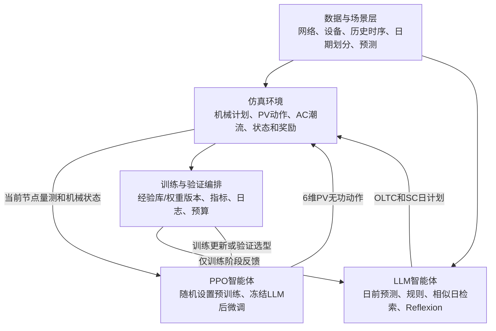

# 两阶段电压控制：系统选型与 Proposed 实施顺序

日期：2026-11-02。承接本对话的 [论文架构与基线梳理](paper-card.md)。本轮按用户最新要求：先选系统，先完成 Proposed，之后由同一实现派生对照；MISOCP 单独补做优化参照。本文件的实施顺序优先于前一份报告第10.8节。

**选型建议：以 MATPOWER/pandapower 的标准 Baran–Wu 33节点径向配电网为首个系统，采用 MAPDN 的处理后负荷与光伏时序，按目标论文重新配置3个区域、1台OLTC和3台电容器。141节点作为后续扩展。**

这是可实施的机制复现方案，不是已获得目标论文原始数据，也没有证据表明 MAPDN 时序就是目标论文使用的时序。

## 1. 已找到的模型与数据

| 候选 | 网络/数据内容 | 与目标任务的适配 | 本轮结论 |
|---|---|---|---|
| MATPOWER `case33bw` + MAPDN时序 | 标准33节点网参；32路P负荷、32路Q负荷、6路PV有功 | 网络来源与目标论文一致；PV接入节点吻合；区域和机械设备需按目标论文设置 | **首选** |
| MATPOWER `case141` + MAPDN时序 | 标准141节点网参；MAPDN有相应数据 | 规模适合扩展；MAPDN原设9区域/22PV，与目标论文5区域/10PV不同，需要重建映射 | 第二阶段 |
| SimBench | 配套网络、全年负荷与发电曲线，15分钟分辨率 | 网络与时序配套；可作为另一组场景或独立数据来源；替换主系统会偏离当前论文网络 | 后续验证/备选 |
| PowerGym / RL_VVC_dataset | IEEE13/34/123/8500等系统，环境或历史运行数据 | 任务设置、设备/动作与当前论文有差别；不是当前33节点问题的直接替代 | 本轮不选为主系统 |

主来源：

- [MATPOWER case33bw.m](https://github.com/MATPOWER/matpower/blob/master/data/case33bw.m)
- [MATPOWER case141.m](https://github.com/MATPOWER/matpower/blob/master/data/case141.m)
- [pandapower网络接口](https://pandapower.readthedocs.io/en/latest/networks/power_system_test_cases.html)
- [MAPDN环境与下载说明](https://github.com/Future-Power-Networks/MAPDN)
- [MAPDN数据集与来源说明](https://huggingface.co/datasets/hsvgbkhgbv/Multi-Agent-Power-Distribution-Networks)
- [MAPDN的33节点生成脚本](https://github.com/xuwkk/gen_pandapower_pv/blob/master/bus33bw.py)
- [SimBench数据入口](https://simbench.de/en/download/datasets/)、[时序接口](https://simbench.readthedocs.io/en/stable/profiles.html)
- [PowerGym](https://github.com/siemens/powergym)、[RL_VVC_dataset](https://github.com/yg-smile/RL_VVC_dataset)

## 2. 为什么主系统选33节点

### 2.1 网络参数已可获得，静态结构核验通过

保存的当前 `case33bw.m` 快照具备：

| 项目 | 已核验值 |
|---|---|
| 节点数 | 33 |
| 参考节点 | 1；参考相角取0 |
| 额定电压 | 12.66 kV |
| 当前源文件功率基准 | 10 MVA |
| 支路记录 | 37条，其中32条闭合、5条联络线断开 |
| 连通与径向性 | 静态图检查通过 |
| 基准有功/无功负荷 | 3.715 MW / 2.3 MVAr |

核验输出：[network_static_checks.json](source_checks/network_static_checks.json)。参数快照：[case33bw.m](source_checks/case33bw.m)。本轮**没有执行潮流计算**；上述检查不代表运行场景已可控或全天潮流一定收敛。

同一标准算例在不同软件版本中可能使用不同功率基准。例如旧版在线MATPOWER文档出现100 MVA，而当前获取的源文件为10 MVA。实现时按同一快照转换阻抗标幺值，不能将不同版本的基准和标幺阻抗混用。

### 2.2 光伏接入位置与目标论文吻合

MAPDN生成脚本的零基索引：`[12,17,21,24,28,32]`。

转换为论文的一基节点号：`[13,18,22,25,29,33]`，与目标论文33节点拓扑中的6个光伏节点一致。这支持复用其时序与设备列顺序，但不证明两个研究使用相同的数据或容量。

### 2.3 按论文重设的设备与区域

| 项目 | 首个系统的目标配置 | 依据/状态 |
|---|---|---|
| OLTC | 节点1根电压，档位-5至5，单档0.006 p.u.，每日最多4次后续调整 | 论文正文与补充提示词 |
| SC | 节点4、9、26，各0.15 MVAr | 补充拓扑人工核读；容量见正文Table I |
| PV | 节点13、18、22、25、29、33 | 论文图与生成脚本交叉核对 |
| PV无功能力系数 | 0.3 | 正文Table I |
| 区域1 | 2–5、19–25；PV为22和25，SC为4 | 按论文补充拓扑核读 |
| 区域2 | 8–18；PV为13和18，SC为9 | 同上 |
| 区域3 | 6–7、26–33；PV为29和33，SC为26 | 同上 |
| 时间尺度 | 日前24小时计划；日内15分钟×96步 | 正文实验设置 |
| 电压评价范围 | [0.95,1.05] p.u. | 正文实验设置 |

3个区域恰好覆盖全部32个非参考节点，各节点只出现一次。节点1不分配负荷预测区域，其电压是否计入奖励按论文全节点目标明确处理。编码时保留显式一基/零基映射，不能让数组索引代替节点编号。

**尚未冻结的参数**：6台逆变器额定视在容量、历史负荷/PV的尺度、初始机械状态、跨日衔接和预测噪声细节。这些应在下一步用训练数据校准并留档，不能根据测试结果反复调整。

## 3. 历史数据：已核验到什么程度

### 3.1 MAPDN是优先数据来源

数据集说明称其使用3年数据：负荷由葡萄牙232个用户的用电数据加工，PV来源于比利时Elia的多区域数据。它们用于构造仿真场景，**不能称为同一真实33节点馈线的现场联合量测**；尤其不能仅因存在 `load_reactive.csv` 就认定其中无功全部为原始实测。

直接入口：[数据集页面](https://huggingface.co/datasets/hsvgbkhgbv/Multi-Agent-Power-Distribution-Networks)。已记录版本：`a41d8c269e402a827d36d9a153a4bce73a990e53`。

本轮通过HTTP Range读取ZIP目录和CSV开头，实际收到约26.9 kB数据，没有先下载整个压缩包。

| case33文件 | 内容 | 压缩后大小 | 原大小 |
|---|---|---:|---:|
| `load_active.csv` | 32路负荷有功 | 128.11 MB | 351.66 MB |
| `load_reactive.csv` | 32路负荷无功 | 154.38 MB | 356.50 MB |
| `pv_active.csv` | 6路PV有功 | 14.55 MB | 54.30 MB |
| `model.p` | pandapower网络模型 | 0.012 MB | 0.039 MB |
| 合计 | 33节点所需文件 | **约297.05 MB** | **约762.49 MB** |

包含33/141/322三个系统的整个 `voltage_control_data.zip` 为3,763,536,396字节，约3.76 GB。可按ZIP目录只取case33相关成员；其可访问性已通过小样本验证，完整提取尚未执行。大型原始包、缓存及转换数据届时放在 `D:\Codex\cache` 或 `D:\Codex\outputs`，当前对话目录只保留脚本、配置、样本和核验报告。

### 3.2 样本中直接看到的事实

- 有功/无功负荷文件均为 `DateTime` + 32个数值列。
- PV有功文件为 `DateTime` + 6个数值列。
- 开头时间为 `2012-01-01 00:03:00`，后续为00:06、00:09、00:12、00:15，间隔3分钟。
- 环境代码把负荷列赋给pandapower的 `p_mw` / `q_mvar`，PV列赋给 `sgen.p_mw`。
- 原生成代码保持负荷排序；仍需在完整载入后核对CSV列到负荷表、节点的映射。

证据：[mapdn_dataset_inspection.json](source_checks/mapdn_dataset_inspection.json)；[有功样本](source_checks/load_active_sample.txt)、[无功样本](source_checks/load_reactive_sample.txt)、[PV样本](source_checks/pv_active_sample.txt)。

**证据边界**：3年覆盖是发布者说明；本轮只检查目录、文件尺寸、列结构和开头样本，没有逐行检查完整日期范围、缺失值、重复值或异常峰值。3分钟是发布后文件的分辨率，不能等同于原始仪表原生3分钟采样。

### 3.3 如何用于训练、验证和测试

当前要复现的是PPO在线交互训练。需要历史负荷与PV作为外生场景，不需要先取得专家动作标签：

```text
历史P/Q负荷、PV有功
    → 潮流环境提供当前状态
    → PPO选择无功动作
    → 潮流计算动作后的电压
    → 得到reward和下一状态
```

这里的“在线交互训练”发生在离线仿真中，不是接入真实电网训练。

建议在完整数据质检后再冻结日期清单：

1. 以完整日/连续时间块为单位划分，保留训练、验证、最终测试三部分。
2. 若3年时间轴完整，优先采用前2年训练，后续一段验证、最后一段测试的时间顺序方案；具体截止日期在全量时间轴核对后确定。
3. 训练日供PPO预训练、LLM经验库与Reflexion、PPO微调使用；验证日用于选超参数与checkpoint；最终测试日仅评估冻结策略。
4. 日前仅给24小时区域净负荷预测，日内逐步给当前节点量测；未来真实值保留在环境中。
5. 3分钟到15分钟采用对齐后的5点聚合，先确认时间戳表示区间起点还是终点。不要任意从00:03开始按5行分组导致跨小时错位。
6. 只在训练数据上确定归一化、容量估计和尺度参数。固定逆变器额定容量后，测试时不按测试峰值重新估算设备能力。
7. 从冻结测试集选文献对齐的25个测试日/种子，并同时保留完整测试集汇总。相同日可用于跨种子配对，不能把75个测试episode称为75次独立训练。

聚合规则、预测误差生成和验证截止日期属于实现约定，不是从目标论文补齐的原始配置。建议另保留3分钟下极值诊断，观察15分钟聚合是否掩盖短时越限。

### 3.4 SimBench作为备用的理由与限制

SimBench提供全年15分钟时序及其与网络元件的映射，省去了拼接不同来源的部分工作。也可以只取profiles用于33节点，但这时需要自行声明节点分配及缩放规则。

其负荷包含实测数据加工，PV等发电曲线则有真实气象驱动的模型生成成分，不能将所有曲线统一称作实测。见[时序数据方法原文](https://simbench.de/wp-content/uploads/2025/11/time_series_preprint.pdf)。官方数据许可为ODbL，见[下载与许可页](https://simbench.de/en/download/)。本轮仅核验文档，没有下载或逐行审计SimBench数据。

## 4. 为什么复用数据，而不直接照搬MAPDN环境

| 设置 | MAPDN当前公开实现 | 本次Proposed目标 |
|---|---|---|
| 控制组织 | 分布式/分区多智能体 | 单个集中式PPO输出6维PV无功 |
| 33节点区域 | 4个控制区域+主干 | 论文的3区域 |
| 慢设备 | 主要围绕PV无功任务 | 加OLTC日前计划和SC连续投切区间 |
| 单步时长/日长度 | 数据为3分钟；示例episode_limit=240 | 15分钟，96步/日 |
| 奖励 | 电压barrier + 无功等权重项 | 节点平均绝对电压偏差的负值 |
| 动作范围 | 按场景设置action_scale | 论文33节点系数0.3及当前容量映射 |
| 仿真扰动 | 代码可给实时数据叠加单侧随机扰动 | 日前预测误差与日内真实数据明确分开 |
| 逆变器容量 | 当前代码用全时序最大有功×1.2 | 优先按预先声明设备容量；若估计则仅用训练部分 |

核验来源：[MAPDN环境代码](https://github.com/Future-Power-Networks/MAPDN/blob/main/environments/var_voltage_control/voltage_control_env.py)、[环境配置](https://github.com/Future-Power-Networks/MAPDN/blob/main/args/env_args/var_voltage_control.yaml)。

目标论文主文的奖励为 \(-\sum_i |V_i-1|/|\mathcal N|\)。默认引入其他损失、保留MAPDN随机采样方式或区域划分，都会改变待复现问题。本轮建议借用其数据和网络构造参考，Proposed按目标论文重新定义环境接口。

## 5. 三大核心模块，加两层公共支撑

你的“三大块”划分是对的：仿真环境、RL智能体、LLM智能体。为了训练和验证可以追溯，再明确两层公共支撑即可。



| 模块 | 应做什么 | 最小验收 |
|---|---|---|
| 数据与场景层 | 网络/设备配置、时序清洗聚合、train/val/test、区域日前预测 | 同一天输入能被重复生成；三套日期隔离 |
| 仿真环境 | AC潮流、OLTC/SC计划执行、PV无功映射、观测和奖励 | 潮流收敛；动作方向正确；96步完整运行；奖励与电压一致 |
| PPO智能体 | 集中式连续控制器、预训练与微调、模型存取 | 接口正确且能在不同机械设置下学习；学习曲线可复现 |
| LLM智能体 | 提示词、解析、规则校验、相似日经验库、反思更新 | 日计划合法；反馈来自训练日；在线无Reflexion更新 |
| 训练验证编排 | 阶段切换、冻结、checkpoint、配对测试、成本统计 | 能追踪每次结果对应数据、经验库、PPO权重与配置 |

所有模块共用同一份网络、设备、区域和日期配置。后续基线通过替换控制器或关闭某机制派生，不复制一套独立潮流模型。

## 6. 我建议的实现顺序

### 第一步：冻结首个系统与输入契约

主系统确定为33节点；141暂留扩展。明确节点映射、三分区、设备参数及每日时序格式。先定义两个接口：日前计划结构；日内 `reset(day_id, schedule)` / `step(q_action)` 的输入输出。

交付：系统配置、设备/区域映射、场景文件格式、可追溯来源。

### 第二步：完成数据处理与潮流环境

取case33完整数据，质检和聚合到15分钟。用简单固定计划检查一天运行：升降OLTC是否改变总体电压、投入SC是否改变局部电压、PV吸收/注入无功方向是否正确。保留P/Q注入正号约定、根节点电压及参考相角定义。

这一步的零动作和固定动作只用于环境检查，不需要先训练一套比较方法。MISOCP尚未实现，也应能够根据已知静态算例与功率平衡检查环境正确性。

交付：一天96步仿真、节点电压与动作图、收敛/约束/奖励核验记录。

### 第三步：搭PPO，并开始预训练

先接入状态向量、机械状态one-hot、6维连续动作及论文奖励。按随机机械设备设置预训练，保存权重。PPO不依赖LLM才能预训练，因此环境稳定后可先验证学习链路。

交付：可重复训练脚本、预训练权重及验证结果。随机设置的采样频率、是否按合法日计划采样，需列为复现约定，不把正文未公开细节写成作者设定。

### 第四步：搭LLM，并离线改进经验库

先完成一次合法日前计划生成，再加入相似日检索、日仿真反馈、3轮Reflexion和经验库更新。此阶段与PPO预训练在依赖上独立，但共用已核验环境。

交付：提示词版本、调用原始记录、经验库快照、改进前后训练/验证表现。这里不涉及LLM权重微调。

### 第五步：冻结LLM，微调PPO

固定经验库与日前生成规则，把已预训练PPO转入LLM计划下的环境微调。这才是Proposed两个控制器的正式协同阶段。暂不增加反复交替更新两个控制器的新训练流程。

交付：完整Proposed的冻结经验库、PPO最终权重、可重复的推理入口。

### 第六步：独立测试，再扩展比较

验证集选择完成后，冻结配置并评估独立测试日；报告电压偏差、越限率、动作合法率、失败场景、LLM调用和训练交互成本。然后由Proposed派生No-PT、No-Reflexion及其他对照，再扩展141节点。

MISOCP单独实现，但读取同一网参、设备和场景；其优化计划回代AC潮流重新评价。它提供优化参照，不能替代前面潮流环境自身的正确性验证。使用准确未来节点预测时应保留oracle标签。

## 7. 当前完成状态与下一步

已完成：

- 找到并保存33/141节点参数快照；核验连通、径向、参考节点、基准量和33节点负荷总量。
- 核对MAPDN生成脚本的6个PV节点，与目标论文吻合。
- 实际读取数据包目录与case33三类CSV开头；记录固定数据版本和文件尺寸。
- 整理按Proposed优先的模块边界与实施顺序。

尚未完成：全量case33数据获取/质检、潮流环境搭建、PPO/LLM训练、独立测试与MISOCP实现。

**下一步应是“33节点系统配置 + case33数据处理 + 一天96步环境验收”。** 额定容量、时序尺度与初始状态在这一步核实，不需要先把其他比较方法搭完。

