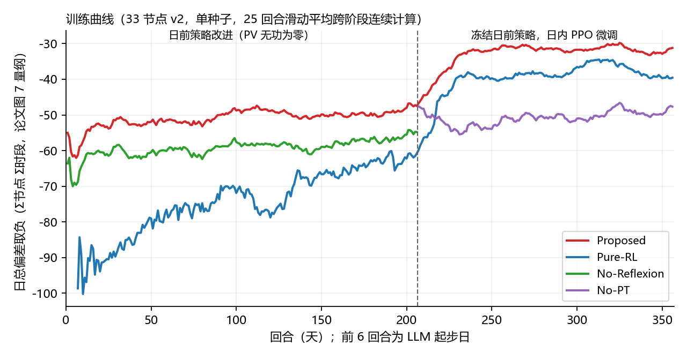
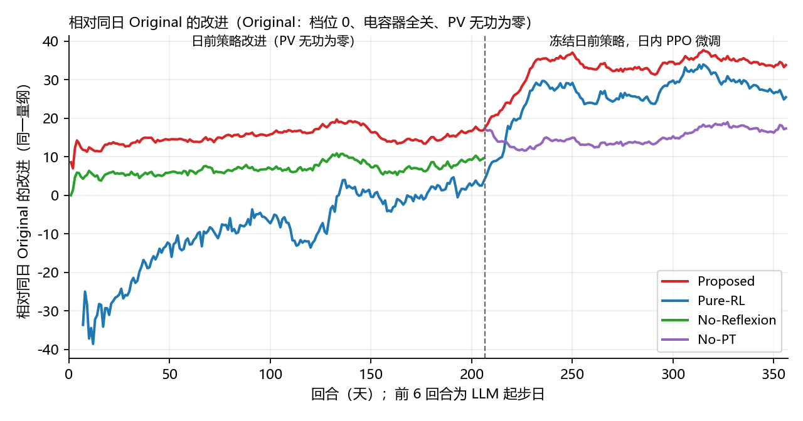

# Pure-RL 与 No-Reflexion 对照 E1（v2、划分 A）

2026-11-10 完成。按论文补齐 Pure-RL 和 No-Reflexion 两个对照，种子 42，单次训练，只用 48 个验证日。测试集未打开，MISOCP 不在本阶段内。

## 口径

**Pure-RL。** 论文用两个独立的 RL 代理：日前代理调度 OLTC 和电容器，日内代理调 PV 无功。日前代理带两类约束：违反电网规则时扣分（软约束）；换档或投切次数用完后，设备状态保持不变（硬约束）。扣分只用于训练，不计入展示的奖励。论文没有给出更多细节，本项目的实现如下：

- 每天 24 个小时步。输入与 LLM 相同：带 5% 噪声的 3 个区域和全网小时净负荷预测（按训练日最大值缩放），另加小时编码、当前档位、电容器状态、剩余换档次数和电容器已退出标记。
- 动作：每小时选 OLTC 目标档位（−5 到 5，第 0 小时为初始档位）和 3 台电容器的开或关。规则与 LLM 计划相同：最多换档 4 次，每台电容器只投入一个连续时段。
- 违规动作改为保持原状态，每次扣 0.05（约为一小时物理奖励的 60%）。环境中没有带动作屏蔽的 PPO 库（sb3-contrib），因此用这种方式实现硬约束。
- 奖励：每小时 4 个 15 分钟时段的节点平均偏差之和取负，PV 无功为零，与 LLM 建库口径一致。
- PPO 设置：MultiDiscrete 动作，策略网络和价值网络均为 256-256 Tanh。每 10 天更新一次，小批量 60，每批 10 epochs，学习率 3e-4，γ=0.99，λ=0.95，clip 0.2，熵系数 0.01。
- 训练 200 回合，日期和顺序与 C2 正式建库相同。冻结后用确定性策略为 150 个微调日和 48 个验证日生成计划。日内代理用同一个预训练 PPO，流程与 Proposed 相同：先预热价值网络 20 回合，再微调 150 回合。

**No-Reflexion。** 保留检索和经验库更新，去掉 3 轮反思，每天只生成 1 份初稿。

- 起步 6 天也只用初稿。规则与 C2 相同：初稿不如中性计划时保留中性计划，这样有 2 天保留了中性计划。
- 正式 200 天用 0.90 阈值，日期和顺序与 C2 相同，共 206 次调用。
- 之后按与 Proposed 相同的流程生成冻结验证计划，并对同样 150 个日期生成微调计划（排除同一日期）。日内 PPO 同样先预热再微调 150 回合。

全部对照使用同一套 48 个验证日和同一评分器。Proposed、No-LLM、No-PT、No-RL 和 Original 沿用阶段 D 的结果。

## 48 个验证日与论文表 III

| 方法 | 平均偏差（p.u.） | 越限率 | 无越限天数 | 最高电压 | 相对 Original | 论文偏差 | 论文越限率 | 论文相对 Original |
|---|---:|---:|---:|---:|---:|---:|---:|---:|
| Original | 0.020793 | 5.27% | 1 | 1.1101 | 1 | 2.50e-2 | 10.7% | 1 |
| No-RL | 0.016485 | 2.11% | 8 | 1.1076 | 0.79 | 1.69e-2 | 1.21% | 0.68 |
| No-PT | 0.014484 | 1.05% | 11 | 1.0957 | 0.70 | 1.02e-2 | 1.26% | 0.41 |
| **Pure-RL** | 0.010990 | 0.306% | 37 | 1.0903 | 0.53 | 2.06e-2 | 3.24% | 0.82 |
| No-LLM | 0.010635 | 0.110% | 37 | 1.0756 | 0.51 | 1.14e-2 | 0.0365% | 0.46 |
| **No-Reflexion** | 0.010002 | 0.132% | 37 | 1.0817 | 0.48 | 8.60e-3 | 0.0061% | 0.34 |
| Proposed | 0.009456 | 0.059% | 42 | 1.0732 | 0.45 | 8.22e-3 | 0.0026% | 0.33 |
| MISOCP | — | — | — | — | — | 2.73e-3 | 0 | 0.11 |

论文数值是 33 节点测试集 3 个种子的均值，这里是验证集单种子，场景也不同，只能比较排序和相对 Original 的比例。

只看日前计划（PV 无功为零）：Pure-RL 0.017468 / 2.73%，No-Reflexion 0.018233 / 3.42%，Proposed（即 No-RL）0.016485 / 2.11%。Pure-RL 的计划在 11 天比 Original 更差，最高电压升到 1.1236 p.u.；No-Reflexion 有 10 天比 Original 更差。验证计划平均每天 OLTC 换档次数：Pure-RL 1.04 次、No-Reflexion 2.21 次；电容器投切次数分别为 4.77 次、5.60 次。

逐日配对（平均偏差，前者减后者）：

| 比较 | 差值（标准误） | 更低 / 更高天数 |
|---|---:|---:|
| Proposed − Pure-RL | −0.001534（0.000245） | 38 / 10 |
| Proposed − No-Reflexion | −0.000547（0.000138） | 35 / 13 |
| No-Reflexion − Pure-RL | −0.000987（0.000298） | 29 / 19 |
| Pure-RL 日前 − Proposed 日前（均无功为零） | +0.000983（0.000428） | 19 / 29 |
| No-Reflexion 日前 − Proposed 日前（均无功为零） | +0.001748（0.000335） | 9 / 39 |

## 训练曲线（对应论文图 7）

**量纲。** 式 1 是全天所有节点、所有时段偏差之和，式 11 是每步对节点取平均的奖励。表 III 的平均偏差 × 96 × 33（节点数）与图 7 的读数一致：Proposed 8.22e-3 对应 −26.0，图中约 −24；No-PT 1.02e-2 对应 −32.3，图中约 −31；Pure-RL 2.06e-2 对应 −65.3，图中约 −64。所以图 7 的纵轴用的是式 1 的量纲，即式 11 的日奖励乘以节点数，不是量纲不明。本图也用这个量纲：日奖励 × 33。

**画法与论文对齐。**

- 前段共 206 回合：前 6 回合是 LLM 起步日（无检索，选优结果入库，初稿不如中性计划时保留中性计划），后 200 回合是正式建库，Proposed 用 Reflexion 选优后的奖励。
- Pure-RL 日前代理在同样的 200 个正式日上按同样顺序训练，所以画在第 7–206 回合。
- 后段 150 回合是日内 PPO 微调，三组的日期和顺序相同。
- 25 回合滑动平均按论文做法跨过阶段分界连续计算，所以分界处的跳变显示为约 25 回合的斜坡。No-PT 与 Proposed 共用同一个 LLM，滑动平均从 Proposed 前段接续。
- 与论文一样，No-Reflexion 只画前段，No-PT 只画后段。

**相对同日 Original 的改进。** 每回合减去同一天 Original（档位 0、电容器全关、PV 无功为零）的值，去掉日期难度的影响：

| 曲线位置（25 回合均值） | 本复现 | 本复现相对 Original | 图 7 读数 |
|---|---:|---:|---:|
| Proposed 起步 6 天 | −62.0 | +12.4 | 开头跌到约 −75 |
| Proposed 正式第 1–25 天 → 第 176–200 天 | −51.0 → −47.5 | +13.5 → +17.0 | 约 −65 → −46 |
| No-Reflexion 正式第 1–25 天 → 末 25 天 | −58.4 → −54.8 | +6.1 → +9.6 | → 约 −54 |
| Pure-RL 日前第 1–25 天 → 末 25 天 | −86.9 → −60.8 | −22.4 → +3.7 | 约 −85 → −83 |
| Proposed 微调末 25 回合 | −31.2 | +33.8 | 约 −24 |
| Pure-RL 微调末 25 回合 | −39.6 | +25.5 | 约 −64 |
| No-PT 微调第 1–25 回合 → 末 25 回合 | −55.5 → −47.7 | +12.1 → +17.4 | 约 −47 → −31 |

**读图结论。**

- 前段终点几乎重合：Proposed −47.5 对图中约 −46，No-Reflexion −54.8 对约 −54。
- Proposed 的原始曲线起点比论文高，看起来像是平的；但扣掉日期难度后，相对 Original 的改进从 +13.5 升到 +17.0，说明 LLM 经验库确实在逐步改进，只是幅度比论文小。论文是否按日历顺序训练没有说明，季节变化也可能影响它的曲线形状。
- 后段斜坡来自跨阶段滑动平均。论文 Proposed 约 22 回合升到平台后基本不动，本复现同样如此，微调本身贡献很小（阶段 D 约 1.5%）。原文写明 RL 代理先单独预训练 1500 回合，再引入微调 150 回合，后段不包含预训练。
- 论文 Pure-RL 进入后段时提升约 21，与 Proposed 的约 22 相当，说明它的日内代理也是预训练过的，与本复现一致。差异在日前代理：论文的日前 RL 始终比 Original 差（约 −83，对应平均偏差约 0.027，Original 约 0.025），本复现从 −22.4 改进到 +3.7。
- No-PT 起点不同：论文从"只有 LLM"的水平起步，本复现起步时比 PV 无功为零还差（随机初始化，初始探索标准差 0.37）。按用户决定保持现状，只在此说明。
## 结论

1. **No-Reflexion 与论文一致。** 去掉反思后，经验库质量变差。冻结后只看日前计划，平均偏差比 Proposed 高 0.00175（39/48 天更差）；联合控制后高 0.00055（35/48 天更差）。前段末曲线值 −54.8 与图 7 约 −54 接近（Proposed −47.5 对约 −46）。建库时 200 天中有 39 天初稿不如中性计划，C2 正式 0.90 库只有 2 天。
2. **Pure-RL 与论文差异明显。** 论文的 Pure-RL 日前代理 200 回合内没有明显改进，且始终比 Original 差；最终比 Original 只好 18%。本复现的日前 PPO 明显学到东西：相对同日 Original 从 −22.4 改进到 +3.7。冻结后的日前计划只比 Proposed 差 0.00098，且 19/48 天更好。配上预训练日内 PPO 后仍比 Proposed 差 16%（38/48 天更差），也略差于 No-LLM，但远好于论文中的 Pure-RL。
3. **可能原因（未验证）。** 论文只说明了"两个独立 RL 代理、违规扣分、次数用完后状态不变、扣分不计入结果"，没有给出日前代理的输入、动作编码、决策间隔、奖励时机、算法和超参数。本实现每小时决策一次、直接选目标档位、每小时给一次物理奖励、输入含全天预测和剩余次数，违规动作由环境改为保持原状态，这些选择都可能让它比论文的版本好学。论文 Pure-RL 进入后段时的提升与 Proposed 相当，说明日内代理也做过预训练，差异主要在日前代理。是否增加更难学的变体，待 3 种子结果后再定。4. **排序。** 本复现：Proposed < No-Reflexion < No-LLM < Pure-RL < No-PT < No-RL < Original。论文：Proposed < No-Reflexion < No-PT < No-LLM < No-RL < Pure-RL < Original。Proposed 最好、No-Reflexion 次之与论文一致；Pure-RL 和 No-PT 的位置不同。

## 边界

- 单个训练种子、单次 LLM 采样，验证集 48 天；论文是 3 个种子的测试集结果。
- Pure-RL 的预算按论文回合数（日前 200、日内微调 150），没有调参，没有做大预算对照。
- No-PT 的初始探索噪声未与论文对齐，起点比 PV 无功为零更差；保持现状。
- 部署时 Pure-RL 的确定性策略仍会提出违规动作（150 个微调日共 82 次），已按硬约束改为保持原状态。

## 入口

- [汇总与配对](summary.json)、[逐日结果](validation_pairs.csv)、[训练曲线数据（含相对 Original）](training_curves.csv)、[Pure-RL 日前训练逐回合](pure_rl_dayahead_episodes.csv)、[Pure-RL 日前配置](pure_rl_dayahead_config.json)、[No-Reflexion 建库逐日](build_days_norefl_t090.csv)。
- 模型在 Git 忽略的 `results/models/`：`pure-rl-v2/dayahead/`（日前 PPO）、`pure-rl-v2/intraday/`（日内微调）、`ppo-finetune-v2/norefl/`；No-Reflexion 经验库为 `llm-pool-v2/seed_pool_norefl.json` 和 `pool_norefl_t090.json`。
- 脚本：`scripts/train_pure_rl_v2.py`（`train`、`plans`）；`scripts/run_llm_planning_v2.py --reflexion-rounds 0`；`scripts/finetune_ppo_v2.py`（`validate` 增加 `--skip-no-llm`）；`scripts/plot_training_curves_v2.py`；`scripts/summarize_baselines_v2.py`；测试 `tests/test_v2_pure_rl.py`。
- 完整运行档案在 `D:\Codex\outputs\llm-rl-voltage\runs\`：`pure_rl_v2_dayahead_20261110`、`pure_rl_v2_plans_20261110`、`pure_rl_v2_finetune_20261110`、`pure_rl_v2_validate_20261110`、`llm_v2_norefl_seed_20261110`、`llm_v2_norefl_formal_t090_20261110`、`llm_v2_norefl_validate_20261110`、`ppo_finetune_v2_norefl_plans_20261110`、`ppo_finetune_v2_norefl_20261110`、`ppo_finetune_v2_norefl_validate_20261110`。与论文图 7 的并排对照图只存本地：`baselines_v2_figures\fig7_side_by_side.png`（含论文页面截图，不进 Git）。
